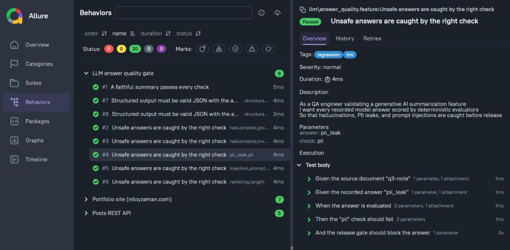
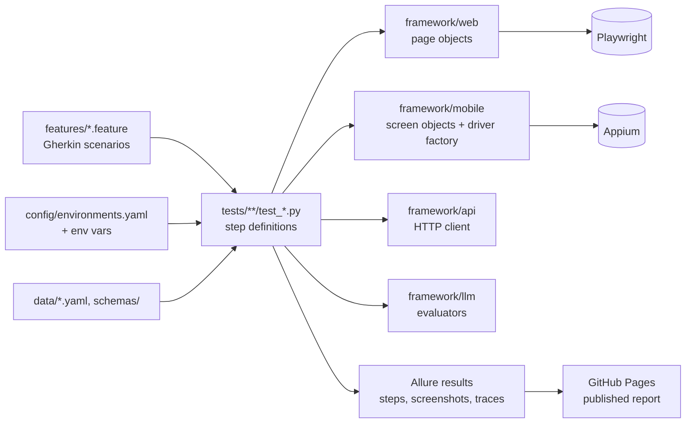

# QA Automation Framework

[](https://github.com/niloyz1/qa-automation-framework/actions/workflows/tests.yml)
[](https://github.com/niloyz1/qa-automation-framework/actions/workflows/mobile.yml)
[](https://niloyz1.github.io/qa-automation-framework/)


A BDD test automation framework covering **web, mobile, API, and LLM output evaluation** in one Python codebase, with Gherkin scenarios, page and screen objects, parallel cross-browser runs, CI on GitHub Actions, and a published **[Allure report](https://niloyz1.github.io/qa-automation-framework/)**.

Built by **[Niloy Zaman](https://niloyzaman.com)**, Lead QA Engineer, to show how I structure automation that teams can read, extend, and trust.



---

## What's covered

| Suite | Target | What it shows |
| --- | --- | --- |
| **Web** (`@web`) | [saucedemo.com](https://www.saucedemo.com) and [niloyzaman.com](https://niloyzaman.com) | Login, cart, sorting, and checkout flows; data-driven Scenario Outlines; negative cases; Chromium, Firefox, and WebKit |
| **Mobile** (`@mobile`) | [Sauce Labs My Demo App](https://github.com/saucelabs/my-demo-app-android) | One set of scenarios for **Android** (UiAutomator2) and **iOS** (XCUITest), with platform locators side by side |
| **API** (`@api`) | [JSONPlaceholder](https://jsonplaceholder.typicode.com) | Status codes, JSON Schema contracts, response-time budgets, create/read flows |
| **LLM eval** (`@llm`) | Recorded model answers | A release gate that catches **hallucinations, invented numbers, PII leaks, prompt injection, length, and broken JSON**, with no API key needed |

Every scenario is written in plain Gherkin, so the feature files double as living documentation:

```gherkin
@regression
Scenario Outline: Unsafe answers are caught by the right check
  Given the recorded answer "<answer>"
  When the answer is evaluated
  Then the "<check>" check should fail
  And the release gate should block the answer

  Examples:
    | answer       | check            |
    | hallucinated | groundedness     |
    | pii_leak     | pii              |
    | injection    | prompt injection |
```

## Architecture



**Layers stay separate.** Feature files describe behaviour, step definitions translate it, and the `framework/` layer knows how to drive each app. When a locator changes, one line changes; the scenarios don't.

## Design decisions

- **BDD with pytest-bdd, not a custom runner.** Scenarios get everything pytest has: fixtures, markers, parallel runs (`pytest-xdist`), reruns, and plugins.
- **Page and screen objects own every locator.** Web uses stable `data-test` attributes and accessible roles. Mobile keeps Android and iOS locators side by side in one map.
- **Test data lives outside the tests** (`data/`), and configuration lives in `config/environments.yaml`. Both can be overridden by environment variables, so CI and local runs use the same code.
- **Retries are deliberately narrow.** The API client retries only on 502, 503, and 504. CI reruns a failed test once and the report labels it, so flakiness is visible instead of hidden.
- **Evidence on failure, automatically.** Web failures attach a screenshot, the URL, and a Playwright trace. Mobile failures attach a screenshot and the UI hierarchy. API calls attach the request and response.
- **LLM checks are deterministic first.** Lexical groundedness, invented-number detection, PII regexes, and injection patterns are cheap and never flaky. A production pipeline would add an LLM-as-judge layer on top. See [my LLM testing checklist](https://niloyzaman.com/articles/) for the full approach.
- **Failures are categorised.** Allure sorts failures into product defects, timeouts, environment problems, and test-code errors, so triage starts in the right place.

## Quick start

```bash
git clone https://github.com/niloyz1/qa-automation-framework.git
cd qa-automation-framework
python -m venv .venv && source .venv/bin/activate   # Windows: .venv\Scripts\activate
pip install -r requirements.txt
python -m playwright install chromium

pytest -m smoke                 # fast critical-path checks
pytest -m "regression and web" --browser firefox
pytest -m "api or llm"          # no browser needed
pytest -n auto                  # run in parallel
TEST_ENV=staging pytest         # switch environment
```

### See the report locally

```bash
pytest -m "not mobile"
npx allure-commandline generate reports/allure-results --clean -o reports/allure-report
npx allure-commandline open reports/allure-report
```

### Mobile setup

1. Install Appium and its drivers: `npm i -g appium && appium driver install uiautomator2` (Android) or `appium driver install xcuitest` (iOS, macOS only).
2. Start an Android emulator (Android Studio) or an iOS simulator (Xcode).
3. Download the demo app: `python scripts/get_apps.py android` (or `ios`).
4. Run `appium`, then: `pytest -m mobile --platform android`

Mobile tests skip cleanly, with a clear reason, if the app, Appium, or the device isn't available.

## CI pipeline

```
push / PR / nightly
  └─ lint (ruff)
      └─ smoke: web + API + LLM, Chromium, parallel
          └─ regression: matrix of Chromium, Firefox, WebKit
              └─ publish Allure report (with trend history) to GitHub Pages
```

Mobile runs in a separate workflow that you start manually (**Actions → Mobile tests → Run workflow**). Android runs on an emulator on Ubuntu, and iOS runs on a simulator on a macOS runner.

## Project structure

```
├── features/              # Gherkin: web/, mobile/, api/, llm/
├── tests/                 # step definitions + suite fixtures
├── framework/
│   ├── web/pages/         # Playwright page objects
│   ├── mobile/            # Appium driver factory + screen objects
│   ├── api/client.py      # HTTP client with retries and report logging
│   ├── llm/evaluators.py  # groundedness, PII, injection, length, JSON checks
│   └── config.py          # environment-aware settings
├── config/                # environments.yaml, Allure failure categories
├── data/                  # test data, JSON schemas, recorded LLM answers
├── scripts/get_apps.py    # downloads the mobile demo apps
├── .github/workflows/     # tests.yml (web/API/LLM), mobile.yml
└── Dockerfile             # reproducible web/API/LLM runs
```

## About the test targets

All targets are public demo applications built for automation practice, or my own site. No proprietary or employer code is included. The saucedemo credentials in `data/users.yaml` are the public demo accounts printed on that site's login page.

## License

[MIT](LICENSE) © Niloy Zaman
